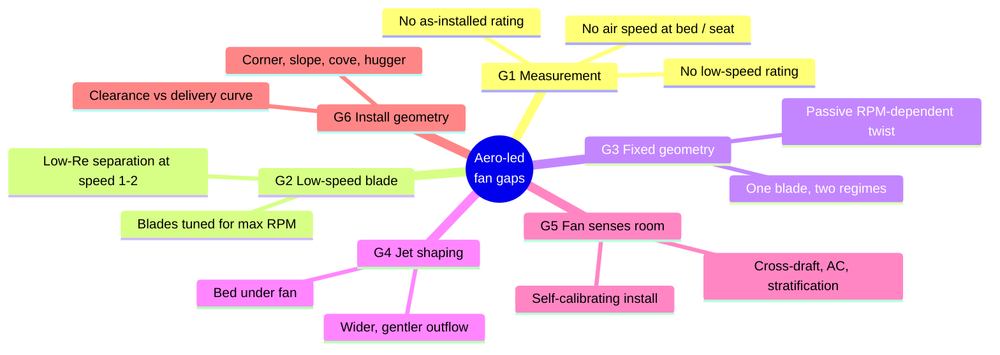

# AtomQuest 2026: Rethinking Ceiling Fan Aerodynamics for Real Indian Rooms

> **Team repo for Atomberg AtomQuest 2026.** We are designing an **aerodynamics-led** ceiling fan innovation. This repo holds everything we researched, how we scored it, what we concluded, and where we're heading next.


---

## TL;DR

- **Our core finding:** fans are **designed and rated** at *maximum speed in an open test chamber*, but people **use** them at *low speed, at night, over a bed, in a cramped real room*. Nobody designs or measures for that real use.
- We studied **28 real-world Indian room and usage conditions** (false ceilings, beds under fans, low-speed sleep, cross-drafts, wardrobes, etc.). Each one got its own deep-research dossier.
- We **scored all 28** on a fixed 7-dimension rubric, grouped them into **6 aerodynamic mechanism clusters**, and narrowed them to **6 addressable gaps**.
- **Current direction:** the **"night-bedroom regime"** (fan on speed 1–2 over a sleeping person), backed by a **"Real-Room Comfort Rating"** test method that we measure ourselves.
- **Status:** research and synthesis are ✅ done. We are 🔄 now researching the solution (speed-pattern control, on-device learning, shape-changing blades). Prototype ⏳ next.

## Depth at a glance

| What | How much |
|---|---|
| Room / usage conditions researched | **28** |
| Condition dossiers | **28** files, ~**123,000 words**, 12 sections each |
| Unique sources cited (papers, patents, standards, product pages) | **~600 links** |
| Claims explicitly flagged `[UNVERIFIED]` | **650+** (we tag what we couldn't confirm instead of hiding it) |
| Scoring cards (verified against the dossiers) | **28**, across 4 files |
| Synthesis documents | comparison, gaps, re-evaluation, rubric (~29,000 words) |
| Follow-up research prompts queued | **3** tech tracks |

---

## 1. How we started

**The brief:** AtomQuest 2026 asks for a next-generation ceiling fan. We chose to compete on **aerodynamics**: blade geometry, airflow shaping and RPM control. Electronics or styling were not our focus.

**The question we asked first:** *"Where does a ceiling fan actually under-perform in Indian homes, and is aerodynamics the fix?"*

Instead of jumping to a blade design, we listed every real situation a fan in India actually faces. That gave us 28 conditions, in five groups:

| Group | Conditions |
|---|---|
| **Ceiling & mounting** | 01 false-ceiling cove · 02 low ceiling / hugger · 03 high ceiling · 04 sloped ceiling · 05 beams · 06 light kit · 07 corner / near-wall |
| **Room shape & scale** | 08 multi-fan hall · 09 long narrow room · 10 small room · 11 open plan · 12 balcony / veranda |
| **Heat & climate** | 13 stratification · 14 sunlit wall · 15 hot roof · 16 humidity / monsoon · 17 fan + AC · 18 exhaust pressure · 19 cross-ventilation · 20 dust / grease |
| **Furniture & people** | 21 tall wardrobes · 22 bed / table under fan · 23 mosquito nets · 24 soft furnishings · 25 high occupancy |
| **Operation & hardware** | 26 voltage / inverter · 27 low-speed / sleep · 28 wobble / vibration |

## 2. How we researched (method)

```mermaid
flowchart LR
    A[28 room conditions<br/>listed] --> B[Standard research prompt<br/>Part A framework +<br/>Part B condition brief]
    B --> C[28 deep-research<br/>dossiers<br/>research/]
    C --> D[Fixed scoring rubric<br/>7 dimensions, max 40]
    D --> E[28 verified score cards<br/>synthesis/cards-*.md]
    E --> F[Cross-condition comparison<br/>tiers + 6 clusters]
    F --> G[6 addressable gaps<br/>gaps.md]
    G --> H[Hostile re-evaluation<br/>reevaluation.md]
    H --> I[Solution research<br/>research_prompts_tech.md]
    I --> J[Prototype + own<br/>test rig]
    style I fill:#fff3cd,stroke:#e0a800
    style J fill:#eeeeee,stroke:#999
```



1. **One prompt framework for all 28.** [`research_prompts_room_conditions.md`](research_prompts_room_conditions.md) has a shared *Part A* (role, Indian context: 2.6–3.2 m ceilings, 1200 mm sweep, 230 V with fluctuations, IS 374:2019, BEE star rating, ASHRAE 55, ISO 7730) plus one *Part B* brief per condition. Every condition was researched in its own deep-research session, so each dossier goes deep and all of them have the same structure.
2. **Every dossier has the same 12 sections.** Condition definition → aerodynamic physics → role of RPM → blade/fan geometry levers → materials → market solutions → academic research → **patent landscape** → unsolved gaps → **measurement plan** → sensors/smart control → summary + sources.
3. **A fixed scoring rubric, applied by every reviewer** ([`synthesis/rubric.md`](synthesis/rubric.md)):

   `TOTAL = FREQ + SEV + UNSOLVED + PATENT_ROOM + 2×AERO_FIT + EVIDENCE + PROTO` (max 40)

   AERO_FIT is **double-weighted** because the pitch is aerodynamics-led. Calibration anchors keep the batches comparable (e.g. EVIDENCE 5 only with condition-specific measured data).
4. **Cards were checked against the dossiers.** Each card's scores cite the report section they come from, numbers are copied exactly, and `[UNVERIFIED]` tags are kept.
5. **Hostile-panel review.** The comparison was audited from four viewpoints (aerodynamicist, Atomberg PM, hackathon judge, patent analyst). See the review log at the end of [`comparison.md`](synthesis/comparison.md).
6. **We then challenged our own conclusions** in [`reevaluation.md`](synthesis/reevaluation.md).

## 3. What we found


### 3.1 Six mechanism clusters
The 28 conditions are not 28 separate problems. They come down to a handful of **shared aerodynamic mechanisms**:

| Cluster | Mechanism | Conditions | Combined score |
|---|---|---|---|
| **A** Hub / inflow starvation | Short blade-to-ceiling clearance or hub blockage starves the jet at its source | 01, 02, 05, 06 | 115 |
| **B** Asymmetric boundary | Wall, slope, wardrobe or corridor on one side → lopsided flow, 1P cyclic loading | 04, 07, 09, 21 | 117 |
| **C** External-flow competition | Cross-draft, exhaust, solar plume or hot ceiling layer fights the jet | 19, 18, 14, 13, 03 | 139 |
| **D** Low-Reynolds regime | At low RPM the blade drops to chord Re ~10⁴ → early separation, lift loss | 27, 23 | 61 |
| **E** Furniture / floor-jet | Bed or table raises the impingement plane → turbulence at the occupant | 22, 24 | 56 |
| **F** System / multi-fan | Uniformity across a room needs coordinated control and spacing | 08, 09, 11, 25 | 120 |

**Out of scope for an aero pitch:** 15 hot roof (radiant heat), 16 humidity (materials), 17 fan + AC (control), 18 exhaust (room pressure), 20 dust (coatings), 26 voltage (BLDC already solves it), 28 wobble (mechanical balance).

### 3.2 Six addressable gaps ([`gaps.md`](synthesis/gaps.md))



| Gap | One-line summary | Covers |
|---|---|---|
| **G1 Measurement** ★ | Star ratings measure max speed in an open chamber. Nobody rates low-speed, as-installed, or at-the-bed performance | 27, 22, 01, 02, 03, 10, 11, 25 |
| **G2 Low-speed blade** ★ | Blades are designed for top speed but run at speed 1–2 for hours each night | 27, 23, 25 |
| **G3 Fixed geometry** ★ | No product or patent in our sources changes blade twist *automatically* with RPM: white space (to be prior-art checked) | 27, 22 |
| **G4 Jet shaping** ★ | Every "sleep mode" just slows the fan. None changes the *shape* of the jet over the bed | 22, 10, 02, 21 |
| **G5 Room-aware fan** | The fan doesn't sense drafts, AC, stratification or how it was installed | 19, 18, 14, 17, 13, 01, 02, 04, 07, 28 |
| **G6 Install geometry** | No data exists on corner, slope, cove or hugger installs | 01, 02, 04, 05, 06, 07, 09 |

### 3.3 Key evidence we're building on
- The CBE Berkeley desk study shows the jet stays within blade-tip width until **< 0.6 m** from a surface. At 0.3 m the speed is **~50%** of the jet peak, so a bed under the fan moves the turbulent impingement zone up to the sleeper (R22 §2).
- Patent literature claims low-RPM-optimised blades give the same airflow at **~140 RPM** that a normal blade needs **~270 RPM** for, and up to **~26%** more air at low speed. These are the vendor's own claims, not independently replicated (R27 §2).
- At **120 RPM**, tip speed is ≈ **7.5 m/s** and the chord Reynolds number falls toward **~10⁴**. That is a different aerodynamic regime from full speed (R27 §2).
- Cross-ventilation air speeds in Indian homes are typically **0.19–0.83 m/s** (R19 §1).
- **IS 374 / BEE star testing appears to cover max speed only.** This is marked `[UNVERIFIED]`, and checking the clause text is on our to-do list.

> **Honesty note:** every top-ranked condition has EVIDENCE 1–3. None of them has a primary, Indian-residential, condition-specific measurement. That is a weakness, **and also our opportunity:** one cheap test rig would produce data nobody has published.

## 4. What we concluded (after re-evaluation)

The first-pass Top 3 was **22 (bed under fan), 27 (low-speed sleep) and 19 (cross-ventilation)**. A critical second pass ([`reevaluation.md`](synthesis/reevaluation.md)) changed that:

- Tier-1 scores differ by **0–3 points**, which is within noise. So we **pitch by mechanism and user moment**, not by score.
- **22 and 27 are the same moment:** a fan on speed 1–2 at night over a bed. We merged them into a single **"Night-bedroom regime"** target.
- **19 was demoted** to a stretch test. Fan downwash (~2–4 m/s) usually overpowers room drafts (0.2–0.8 m/s).
- The "Dual-Regime" concept conflicts with itself: a single fixed blade can't optimise both low-RPM lift and a flatter jet. That is exactly why **G3 (passive RPM-dependent twist)** is interesting.

**Re-ranked direction:**
1. **Night-bedroom regime** (22 + 27, with G2/G3 as the levers)
2. **Real-Room Comfort Rating** (G1): the measurement method that proves #1
3. **Hub / inflow starvation** (01 + 02): false ceilings and huggers, using a clearance-vs-delivery curve
4. *Stretch:* cross-draft (19) and uniformity (25) as extra test cases on the same rig

## 5. How we're proceeding

| Phase | Status | Output |
|---|---|---|
| 1. List 28 real room conditions + prompt framework | ✅ Done | `research_prompts_room_conditions.md` |
| 2. Deep research, one dossier per condition | ✅ Done | `research/01–28` |
| 3. Rubric scoring, comparison, clusters, gaps | ✅ Done (2026-10-09) | `synthesis/` |
| 4. Hostile re-evaluation of our own findings | ✅ Done (2026-10-10) | `synthesis/reevaluation.md` |
| 5. Solution research (3 tech tracks) + verify list | 🔄 In progress | `research_prompts_tech.md` |
| 6. Test rig + baseline data on a stock fan | ⏳ Next | first real-room dataset |
| 7. Prototype blade / control, A/B test | ⏳ Next | measured improvement |
| 8. Pitch | ⏳ Next | deck + demo |

### Solution research in progress ([`research_prompts_tech.md`](research_prompts_tech.md))
1. **Speed-pattern control:** can modulating RPM (natural-breeze gusts) instead of holding a steady speed spread air better and feel cooler at a given temperature and humidity?
2. **On-device tiny AI:** a fully offline model that learns the user's habits (e.g. "changed speed at 11 pm two days running → do it automatically on day 3").
3. **Temperature-triggered shape-changing blades:** SMA, bimetal, LCE or wax actuators that change blade pitch or camber passively between ~25 and 35 °C.

### Planned test rig (our own first-of-its-kind dataset)
| Test | Measures | Gap |
|---|---|---|
| Speeds 1–5, not just max | Service value (m³/min/W) and air-speed map | G1, G2 |
| Bed vs open floor | Air speed and turbulence at 0.6 m (lying) and 1.1 m (seated) | G4 |
| Box fan as cross-draft (0.3–1.0 m/s) | How far the downwash gets pushed | G5 |
| Hugger vs downrod, mock cove | Clearance-vs-delivery curve | G6 |

Tools: anemometer grid, smoke visualisation, true-RMS power meter, sound meter (dB(A)).

### Verify before the pitch
- [ ] IS 374:2019 clause text and BEE star-label test speed
- [ ] Legal status of the whole US 6,039,541 patent family
- [ ] Prior art for passive / aeroelastic variable twist (wind turbines, propellers, fans)
- [ ] Atomberg's RPM per speed step and blade material
- [ ] Full text of Jayasree et al. 2022
- [ ] Quick user survey or review mining to replace the FREQ guesses

---

## Repository map

```
.
├── README.md                              ← you are here (project story)
├── assets/                                ← diagrams used in the docs
├── research_prompts_room_conditions.md    ← prompt framework used for all 28 dossiers
├── research_prompts_tech.md               ← next-phase solution research prompts
├── research/                              ← 28 condition dossiers (raw evidence)
│   └── README.md                          ← index with scores and tiers
└── synthesis/                             ← scoring, comparison, gaps, re-evaluation
    └── README.md                          ← reading order
```

### Suggested reading order for teammates
1. This README (10 min)
2. [`synthesis/reevaluation.md`](synthesis/reevaluation.md): where we stand now (5 min)
3. [`synthesis/gaps.md`](synthesis/gaps.md): the 6 gaps (10 min)
4. [`synthesis/comparison.md`](synthesis/comparison.md): full matrix, clusters, targets, risks (30 min)
5. Any dossier in [`research/`](research/) for deep detail, e.g. [22 bed under fan](research/22-bed-table-under-fan.md) or [27 low-speed sleep](research/27-low-speed-sleep.md)

## How to read the evidence
- `R22 §2` means **research dossier 22, section 2**.
- `[UNVERIFIED]` means we found the claim but couldn't confirm it from a primary source. Don't quote it in the pitch without checking it first.
- `NB` in `gaps.md` marks answers from a NotebookLM follow-up over the dossiers.
- Patent numbers are **directional**, not a freedom-to-operate opinion.

## Team
AtomQuest 2026 team: Girish N and teammates. *(Add names and roles here.)*

## Credits
Research dossiers were produced with deep-research AI tools using the prompts in this repo, then scored, cross-checked and re-evaluated by the team. Diagrams in `assets/` are our own schematics drawn from the dossier findings.
