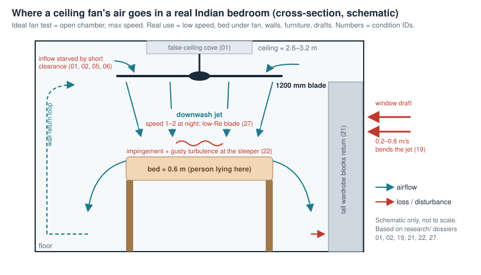
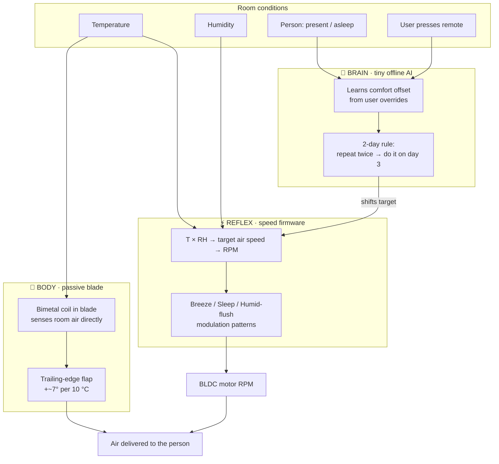
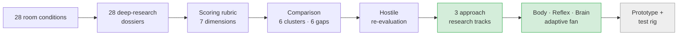
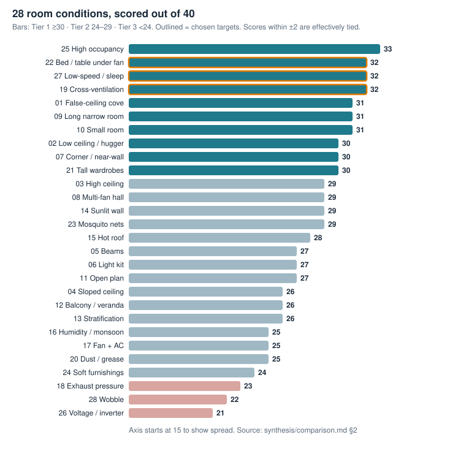

# AtomQuest 2026: The Fan That Adapts — Body, Reflex and Brain

> **Team repo for Atomberg AtomQuest 2026.** We are building a ceiling fan that **adapts to the room and the person under it** in three ways: blades that **change shape with temperature**, motor speed **patterns** tuned to temperature and humidity, and a **tiny offline AI** that learns how you like your fan. This repo has the research behind every decision.



---

## TL;DR

- **The problem we found:** fans are **designed and rated** at *maximum speed in an open test chamber*. People **use** them at *low speed, at night, over a bed, in a real room*, while temperature and humidity change through the night and across seasons. Today's fan does the same thing in all of these situations.
- **Our approach: one fan, three layers of adaptation.**

| Layer | What it is | What it reacts to | Electronics needed |
|---|---|---|---|
| 🦴 **Body** | **Thermally morphing blade**: a bimetal coil turns a trailing-edge flap | Room temperature, with no sensor at all | **None** |
| ⚡ **Reflex** | **Climate-tuned speed patterns**: a temperature × humidity speed map plus gentle "natural breeze" modulation | Temperature and humidity sensor | Firmware on the existing BLDC driver |
| 🧠 **Brain** | **On-device habit learning**: learns the user's comfort offset and applies it after 2 consecutive days | User's remote/app overrides, time, presence | ~₹113 chip, fully offline |

- **Built on evidence:** 28 room-condition dossiers (~123k words) + 3 deep-research reports on the three layers (~24k words), all in this repo.
- **Status:** problem research ✅ · approach research ✅ · prototype build ⏳ next (budget **≈ ₹10,000**).

---

## 1. Our approach at a glance



**Why three layers and not one:**
- The **Body** works even with **no power to the electronics, no Wi-Fi and no app**. It is the most robust layer and the most patentable.
- The **Reflex** turns comfort science (ASHRAE 55, the Indian adaptive comfort model IMAC) into motor behaviour, using hardware the fan already has.
- The **Brain** handles what physics can't predict: *this* person likes it a bit cooler or warmer than the average person.

Each layer stands on its own, so we can demo and test them separately, then show them together.

---

## 2. Layer 1 — 🦴 Body: a blade that changes shape with temperature

**Report:** [Passive Thermally Morphing Ceiling Fan](Approach/Resesarch/Passive%20Thermally%20Morphing%20Ceiling%20Fan.md)

**The idea:** when the room is warm (~28–38 °C), the blade bends into a **higher-pitch, more cambered** shape and pushes more air. When it's cool (~15–24 °C), it **flattens** back and gives a gentle draft-free circulation. No motor, no sensor, no wiring.

### What the research says about materials
We asked for a material with two shapes at two temperatures. The research ranked 8 options:

| Rank | Material / mechanism | Verdict | Why |
|---|---|---|---|
| **1** | **Thermostatic bimetal (helical coil)** | ✅ **Primary choice** | Zero hysteresis, no fatigue, linear and repeatable, cheap (₹800–1,500/kg), proven for decades in rotating car fan clutches |
| **2** | **NiTi shape-memory wire + steel bias spring** | ✅ Backup / "snap" version | High force, clear two-state motion, but needs a custom alloy so the switch happens at 27–33 °C |
| 3 | Paraffin wax actuator | ⚠️ Marginal | Heavy (50–120 g), slow (1–3 min), seals wear out |
| 4 | "Trained" two-way NiTi | ❌ | Shape memory decays 30–60% over time |
| 5–8 | 4D-printed bilayers, Cu-based SMA, shape-memory polymers, liquid crystal elastomers | ❌ | Too soft for a spinning blade (creep, flutter) or too little movement over a 10 °C swing |

> **Key insight:** a true "two-way" smart material is the wrong choice. A **bimetal** is two-way by nature. For NiTi, a **one-way alloy plus a return spring** gives reliable two-way motion without the decay.

### Where on the blade
| Location | Verdict |
|---|---|
| Whole-blade twist | ❌ Too flexible, flutter risk |
| Root pitch hinge | ⚠️ Biggest effect, but the bearing must carry the full ~107 N centrifugal load at 350 RPM |
| Tip winglet | ❌ Changes air delivery by < 3% (helps noise only) |
| **Trailing-edge flap, outer 30–40% of span** | ✅ **Best balance**: the rigid front 75% of the blade carries the loads, and the 15 g flap sees only ~9 N |

### Key numbers (from the report)
- A **250 mm bimetal coil** rotates **~7.4°** for a 10 °C change, with no linkage needed.
- A **100 mm NiTi wire** on a 25 mm crank gives **~5.7°**.
- A **+3° pitch change** (10° → 13°) should give **+11–14% air delivery**. The report targets **12–18%**.
- Thin metal actuators respond to room temperature in **under a minute**. Polymers and wax take 3–10 minutes.
- **Patent picture:** the closest prior art is expired (Aisin 1982 wax/bimetal car fan pitch, US 4,487,551) or covers other fan types (a CN 2025 bimetal solar attic fan). The report found **no active claim on passively morphing ceiling-fan blades**. This still has to be verified.

### Two concepts to prototype
- **Concept A (primary):** a helical bimetal coil in a small fairing drives a trailing-edge flap. Smooth and proportional to temperature, with nothing to wear out.
- **Concept B:** a NiTi wire plus bias spring in the blade root rotates the whole blade between two pitch stops. Two distinct states, with a fail-safe spring return to low pitch.

### Risks we must prove away
- **Balance:** all 3 blades must morph the same way. This needs actuators matched in sets of 3 and blade-tip tracking within ~2 mm.
- **Galvanic corrosion:** bimetal or NiTi touching aluminium in monsoon humidity. Fix: POM bushings and nickel plating.
- **Overshoot at 45 °C+:** this needs hard travel stops.
- **Standards:** the fan must pass the IEC 60335-2-80 overspeed test (1.25× RPM) and keep its BEE star rating. Hot mode draws **~3.5–5 W more**.

---

## 3. Layer 2 — ⚡ Reflex: speed patterns tuned to climate

**Report:** [BLDC Fan Modulation Dynamics](Approach/Resesarch/BLDC%20Fan%20Modulation%20Dynamics.md)

**The question we asked:** are there speeds or speed patterns that spread air better or feel cooler at different temperatures and humidity?

### What we learned (proven vs. myth)
| Claim | Status | What it means for us |
|---|---|---|
| A specific RPM **widens** the air cone | ❌ **Disproven** | The jet's spreading angle stays the same at any RPM. Room coverage comes from the **wall jet along the floor**, so more RPM helps coverage only *indirectly*. |
| Fluctuating "natural breeze" air **feels cooler** than steady air | ✅ **Proven** | Human studies: fluctuations of **0.2–1.0 Hz (peak ~0.5 Hz)** feel cooler, with a *1/f* (pink-noise) pattern like natural wind. |
| Faster modulation saves energy | ❌ **Disproven** | Speeding up and slowing down costs energy. Gentle modulation adds **~+4%**, aggressive modulation **~+28%**. |
| More air always helps in humid heat | ⚠️ **Only up to a point** | Above **~32 °C and 70% RH** sweat can't evaporate, so extra speed adds little. Above ~35–40 °C with high humidity, the fan can even *heat* you. |

### The engineering catch, and our answer
A 1200 mm fan is heavy (rotational inertia ≈ 0.05–0.07 kg·m²). The motor **cannot** swing it at the "ideal" 0.5 Hz without heating up and getting noisy. The research's answer is a **two-tier design**:
1. **Firmware macro-modulation:** slow swings every **10–30 s** of **±10–15%** RPM, with gentle S-curve ramps.
2. **Aerodynamic micro-turbulence:** the blade tips and wake already create the fast **0.3–1.5 Hz** flutter at the person.

> 💡 **This links Layer 1 and Layer 2.** The report lists **passive blade-flutter for micro-gusts** as an *unexplored research gap*. Our morphing flap is the natural place to explore it.

### Three firmware modes we will build
| Mode | When | Pattern |
|---|---|---|
| **Natural Breeze** | Daytime, 26–32 °C | Base RPM from the T×RH table, plus 3 overlaid slow waves (pink-noise-like), accel ≤ 12 RPM/s |
| **Sleep Breeze** | Night | Base speed kept in the **50–150 RPM quiet band (< 32 dBA)**, ±15 RPM over 50 s, accel ≤ **2–3 RPM/s** so the pitch change can't wake you; base steps down as the room cools |
| **Humid Flush** | Monsoon / coastal, hot and humid | Low base speed with a short burst every ~45 s to clear moist air off the skin |

The report also gives a **temperature × humidity → air speed → RPM table** (16 rows, 50–350 RPM). The Reflex layer uses it as its lookup.

### Patents
- Panasonic's **1/f "Yuragi" breeze patent has expired**, so the core idea is in the public domain.
- To design around: Big Ass Fans **US 9,103,346** (SET comfort control with IR occupancy), Xiaomi/Smartmi **CN 107676343** (replaying recorded wind), Crompton **IN 576195** (fan–AC coordination).
- **Atomberg today** uses a timer sleep mode that steps speed down every 1.5–2 h (the two reports give different intervals; this needs checking). It has no temperature or humidity sensing, so there is a clear upgrade path.

---

## 4. Layer 3 — 🧠 Brain: a tiny offline AI that learns you

**Report:** [On-Device Learning Ceiling Fan](Approach/Resesarch/On-Device%20Learning%20Ceiling%20Fan.md)

**The idea:** the fan quietly watches how you use it. If you change the speed at about the same time **two days in a row**, it does it for you **on day 3**. A one-off change is ignored. Everything runs on the fan with no cloud.

### Key findings
- **No neural network needed.** Neural nets on microcontrollers need too much memory, forget old habits, and wear out flash memory. A **Bayesian counter + 2-day hysteresis rule** does the job in **< 2 KB of RAM**, in under 100 clock cycles.
- **Learn the comfort offset, not the clock.** If you pick speed 4 during a 34 °C heatwave, a clock-based fan will still run speed 4 when the monsoon drops the room to 25 °C. Instead, the Brain learns *"this user likes ~X °C cooler than the comfort model says"* and applies it to the Reflex layer's temperature/humidity map. This also **designs around Nest's schedule-learning patents** (US 8,630,742 family).
- **Chip:** **ESP32-C6** (~₹113 in volume; RISC-V 160 MHz, 512 KB RAM, Wi-Fi 6/BLE). It is the same family as the Wi-Fi modules already used in Indian smart fans. It talks to the existing motor controller over UART.
- **Sensors:** SHT40 temperature/humidity (critical), a **24 GHz mmWave radar** that sees a *sleeping* person breathing (PIR misses them), and an ambient light sensor that picks up the "lights off = bedtime" signal.

### Algorithm choice
| Option | Verdict |
|---|---|
| **Binned habit table + Bayesian (Beta) update + 2-day finite-state counter** | ✅ Chosen: tiny, predictable, adapts in exactly 2 days |
| Exponential moving average | ⚠️ A single override shifts it |
| Contextual bandit (LinUCB) | ⚠️ "Exploring" an uncomfortable speed at night loses user trust |
| Hoeffding trees / tiny RNN | ❌ Need months of data / forget unpredictably |

### Real-life details already designed
- **Cold start:** 2-day observation mode, then a safe default comfort curve.
- **Two people disagree:** default toward the lower speed.
- **Seasons:** old habits fade. If the weekly mean temperature shifts a lot, control falls back to physics until new habits form.
- **Power cuts (very common in India):** write to flash once a day, plus an emergency save in ~12 ms when a brownout is detected.
- **Privacy:** 100% local, which keeps it simple under the DPDP Act 2023. Holding the remote button for 10 s wipes all learned data.
- **Trust:** an LED pulses before any automatic change, and a manual command always wins within 50 ms.
- **Success metric:** manual adjustments per day fall to near zero within **7–10 days**, tested first on a **30-day synthetic user simulation**.

---

## 5. How the three layers work together (our new synthesis)

These points come from reading the three reports *together*, not from any single one.

1. **One shared "comfort target".** The Reflex layer turns T × RH into a target air speed. The Brain only *shifts* that target. The Body changes how much air each RPM delivers. So the motor controller always aims at **air speed at the person**, not a fixed speed step.
2. **Don't double-count temperature.** When it gets hot, the blade already pushes ~12% more air at the same RPM. If the Reflex layer also raises RPM, the fan overshoots. **The firmware must know the blade's state.** It can infer it from motor current, because a morphed blade draws ~3.5–5 W more at the same RPM, so this is free to sense.
3. **The Body is the safety net.** If the electronics fail or the user switches smart mode off, the blade still adapts. With a plain wall regulator the fan is *still* smarter than a normal fan.
4. **Morphing flap + gusts = an open research gap.** Using the flap's flexibility to create natural micro-gusts at steady RPM is listed as **unexplored** in the modulation report. This could be our most novel claim.
5. **Sleep is where all three layers meet:** quiet band and slow ramps (Reflex) + learned bedtime offset (Brain) + flatter blade as the room cools overnight (Body). This is the **"night-bedroom regime"** our first-phase research ranked #1.

---

## 6. Prototype plan

| Step | What | Proves |
|---|---|---|
| 1 | **Static chamber test:** blade flap in a 15 → 45 °C box, laser-on-mirror deflection | Morph angle and hysteresis (Layer 1) |
| 2 | **Spin test:** 50–350 RPM on a BLDC stand, strobe for tip tracking, wattmeter | Balance and power (Layer 1) |
| 3 | **Airflow test:** vane anemometer grid 1.5 m below, room at ~20 °C vs 35 °C | +12–18% air delivery claim (Layer 1) |
| 4 | **Breeze modes** on the motor driver: anemometer at bed height, sound meter | Comfort pattern, < 32 dBA in sleep mode, energy penalty (Layer 2) |
| 5 | **Habit engine** on an ESP32-C6: 30-day synthetic log, then live use | 2-day rule, rejecting one-offs, adapting to weather (Layer 3) |

**Prototype bill of materials (from the morphing report, Indian sourcing):** bimetal strip (Shivalik TB 2011), NiTi wire, springs, bearings, PETG flaps, a baseline Atomberg Renesa fan and an anemometer set: **≈ ₹9,989**. Electronics for Layers 2–3 (ESP32-C6 dev board, SHT40, LD2410 radar) are extra, roughly ₹1,500–2,000 (our estimate).

---

## 7. How we got here: problem research (phase 1)

Before choosing a solution, we mapped **where a fan actually under-performs** in Indian homes.

| What | How much |
|---|---|
| Room / usage conditions researched | **28** |
| Condition dossiers | **28** files, ~**123,000 words**, 12 sections each |
| Unique sources cited | **~600 links** |
| Claims flagged `[UNVERIFIED]` | **650+** (we tag what we couldn't confirm instead of hiding it) |
| Approach research reports | **3** (~24,000 words) |





**What phase 1 told us, and how the approach answers it:**

| Phase-1 gap ([`gaps.md`](synthesis/gaps.md)) | Addressed by |
|---|---|
| **G2** Blades are designed for top speed but run at speed 1–2 all night | 🦴 Body (low pitch when cool) + ⚡ Sleep Breeze mode |
| **G3** One fixed blade must serve two regimes; no product changes shape automatically | 🦴 **Body: this is exactly the morphing blade** |
| **G4** Every "sleep mode" just slows down; none changes the air pattern over the bed | ⚡ Sleep Breeze modulation + 🦴 flatter blade |
| **G5** The fan doesn't know its room (temperature, humidity, presence) | ⚡ T×RH map + 🧠 radar / learning |
| **G1** Ratings only measure max speed in an open chamber | Our test rig measures low-speed, at-the-bed, hot vs. cool performance |

Full method: one prompt framework for all 28 ([`research_prompts_room_conditions.md`](research_prompts_room_conditions.md)), a fixed rubric ([`synthesis/rubric.md`](synthesis/rubric.md)), verified score cards, a hostile-panel review ([`comparison.md`](synthesis/comparison.md)) and our own critical re-evaluation ([`reevaluation.md`](synthesis/reevaluation.md)).

---

## 8. Status

| Phase | Status | Output |
|---|---|---|
| 1. 28 real room conditions + deep research | ✅ Done | `research/01–28` |
| 2. Scoring, comparison, clusters, gaps, re-evaluation | ✅ Done (2026-10-10) | `synthesis/` |
| 3. Approach research: Body · Reflex · Brain | ✅ Done (2026-10-10) | `Approach/Resesarch/` |
| 4. Prototype morphing blade (Concept A, then B) | ⏳ Next | deflection, balance, airflow data |
| 5. Firmware breeze modes + habit engine | ⏳ Next | sound, comfort, simulation results |
| 6. Integrated demo + pitch | ⏳ Next | deck + live demo |

### Verify before the pitch
The approach reports are AI deep-research output. Many numbers are model-derived and some patent entries may be inaccurate. Check these before we quote them:
- [ ] **Patent white space for morphing ceiling-fan blades:** run our own Google Patents / InPASS search, plus wind-turbine and propeller prior art
- [ ] Every patent number cited in the three reports (assignee, status). Watch especially the Indian entries (Havells, Atomberg, Crompton)
- [ ] The **+12–18% air delivery** and **+3.5–5 W** figures, by measuring them ourselves (step 3)
- [ ] The T×RH → RPM table and the 0.2–1.0 Hz comfort band, against the original Tsinghua / CBE papers
- [ ] Bimetal flexivity and price from Shivalik's datasheet
- [ ] What Atomberg's sleep mode actually does (90 min vs 2 h step)
- [ ] IS 374:2019 clause text: is low-speed testing really absent?

---

## Repository map

```
.
├── README.md                              ← you are here (project story)
├── Approach/Resesarch/                    ← ★ approach research (3 reports)
│   ├── Passive Thermally Morphing Ceiling Fan.md   ← 🦴 Body
│   ├── BLDC Fan Modulation Dynamics.md             ← ⚡ Reflex
│   └── On-Device Learning Ceiling Fan.md           ← 🧠 Brain
├── assets/                                ← diagrams
├── research/                              ← 28 condition dossiers (problem research)
├── synthesis/                             ← scoring, comparison, gaps, re-evaluation
├── research_prompts_room_conditions.md    ← prompt used for the 28 dossiers
└── research_prompts_tech.md               ← prompts used for the 3 approach reports
```

### Suggested reading order for teammates
1. This README (10 min)
2. The approach report for your layer: [Body](Approach/Resesarch/Passive%20Thermally%20Morphing%20Ceiling%20Fan.md) · [Reflex](Approach/Resesarch/BLDC%20Fan%20Modulation%20Dynamics.md) · [Brain](Approach/Resesarch/On-Device%20Learning%20Ceiling%20Fan.md) (30 min)
3. [`synthesis/reevaluation.md`](synthesis/reevaluation.md): why we chose this direction (5 min)
4. [`synthesis/gaps.md`](synthesis/gaps.md) and [`comparison.md`](synthesis/comparison.md) for the full problem analysis

> **Note:** the approach reports were exported from Google Docs, so their equations are embedded images. Read them in a Markdown viewer that renders images (GitHub, VS Code preview).

## How to read the evidence
- `R22 §2` means **research dossier 22, section 2**.
- `[UNVERIFIED]` means we found the claim but couldn't confirm it from a primary source. Don't quote it in the pitch without checking it first.
- Patent numbers are **directional**, not a freedom-to-operate opinion.

## Team
AtomQuest 2026 team: Girish N and teammates. *(Add names and roles here.)*

## Credits
Research dossiers and approach reports were produced with deep-research AI tools using the prompts in this repo, then scored, cross-checked and re-evaluated by the team. Diagrams in `assets/` are our own schematics drawn from the findings.
