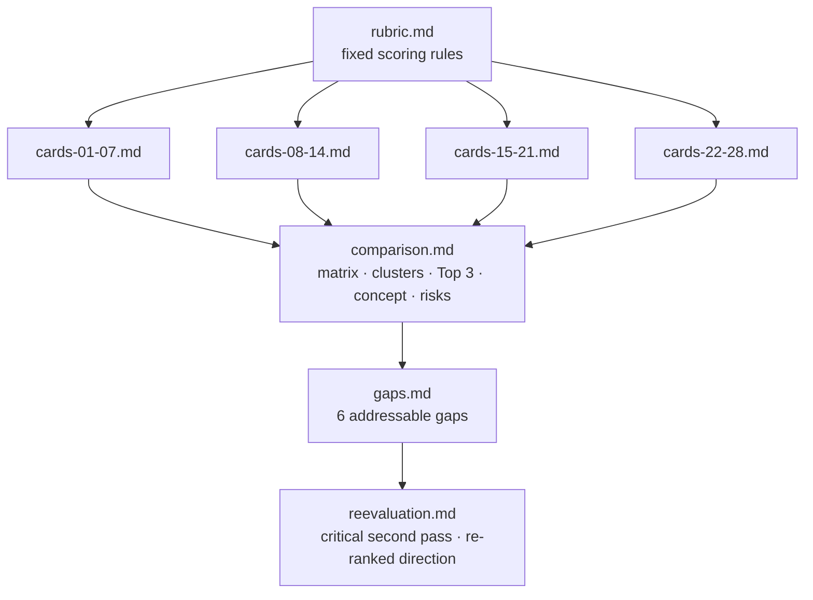

# Synthesis: from 28 dossiers to one direction

These files turn the raw dossiers in [`../research/`](../research/) into decisions. They were produced in this order:

| File | What it is | Read it when |
|---|---|---|
| [`rubric.md`](rubric.md) | The scoring formula, card template and calibration anchors that every reviewer used | You want to know *why* a score is what it is |
| [`cards-01-07.md`](cards-01-07.md) · [`08-14`](cards-08-14.md) · [`15-21`](cards-15-21.md) · [`22-28`](cards-22-28.md) | One card per condition: 7 scores with justifications, top quantified facts, core gap, concept direction, patents, links to other conditions | You need the 1-page version of a dossier |
| [`comparison.md`](comparison.md) | Full tiered matrix, 6 mechanism clusters, first-pass Top 3 (22, 27, 19), combined design concept with engineering risks, drop list, evidence-risk register, review log | You want the full argument |
| [`gaps.md`](gaps.md) | The 28 conditions reduced to 6 gaps (G1–G6), plus what our own test rig would measure first | You're picking what to build |
| [`reevaluation.md`](reevaluation.md) | What holds up, what's weaker than it looks, what the research never covered, and the re-ranked direction | **Start here** for the current state |

## Scoring formula
`TOTAL = FREQ + SEV + UNSOLVED + PATENT_ROOM + 2×AERO_FIT + EVIDENCE + PROTO` (max 40). AERO_FIT is double-weighted because the pitch is aerodynamics-led.

**Treat scores as a filter, not a ranking.** Tier-1 totals sit within ±2 of each other, and every FREQ score is unverified.
